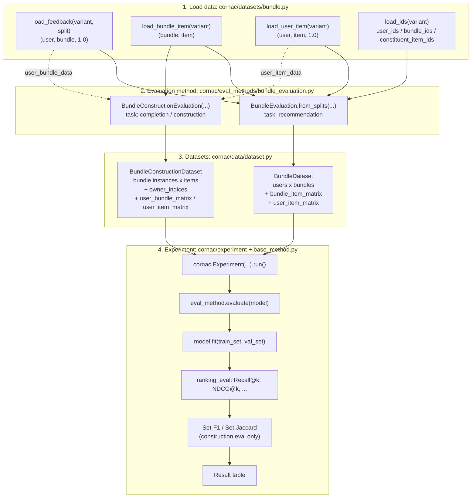
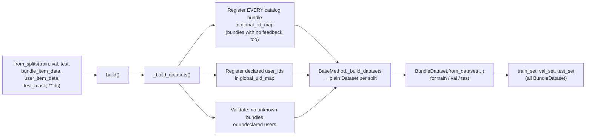
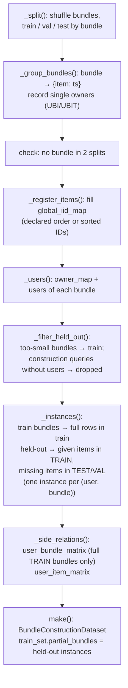
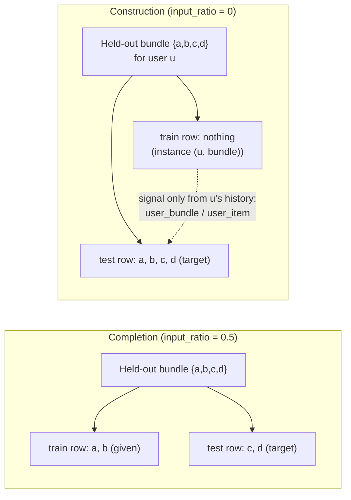
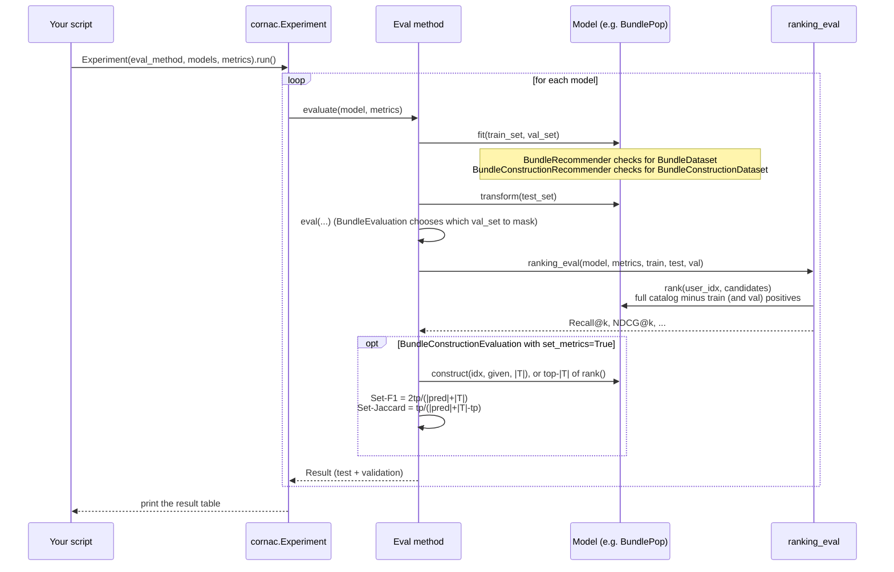

# Bundle Recommendation Workflow in Cornac

How the `BunRec` branch runs bundle tasks end to end, from downloading a dataset
to printing a metrics table. Each step names the source file to read.

Cornac supports three bundle tasks:

| Task | Question it answers | Target | Eval method |
|---|---|---|---|
| **Bundle recommendation** | Which existing catalog bundles will this user like? | bundles | `BundleEvaluation` |
| **Bundle completion** | Given some items of a bundle, which items are missing? | items | `BundleConstructionEvaluation(input_ratio>0)` |
| **Bundle construction** | Build a bundle for this user from scratch | items | `BundleConstructionEvaluation(input_ratio=0)` |

---

## 1. The big picture



The working example is [`examples/bundle_pop_youshu.py`](../examples/bundle_pop_youshu.py),
which runs all three tasks on Youshu with the `BundlePop` baseline.

---

## 2. Step 1: Load the data

File: `cornac/datasets/bundle.py`

| Function | Returns | Notes |
|---|---|---|
| `load_feedback(variant, split)` | `[(user, bundle, 1.0), ...]` | `split` is `train`, `validation` (or `tune`), or `test`: the authors' fixed splits |
| `load_bundle_item(variant)` | `[(bundle, item), ...]` | Bundle membership, which defines the **catalog** |
| `load_user_item(variant)` | `[(user, item, 1.0), ...]` | Side feedback. **Spotify has none** and raises `ValueError` |
| `load_ids(variant)` | `OrderedDict(user_ids, bundle_ids, constituent_item_ids)` | Full ID catalogs, including IDs with no feedback. Pass as `**ids` |

Supported variants: `Youshu`, `NetEase`, `iFashion` (from the CrossCBR archive) and
`Spotify` (from AttList). The first call downloads the files. Later calls read them
from the Cornac cache (`cornac.utils.cache`).

```python
from cornac.datasets import bundle
train      = bundle.load_feedback("Youshu", split="train")
validation = bundle.load_feedback("Youshu", split="validation")
test       = bundle.load_feedback("Youshu", split="test")
memberships = bundle.load_bundle_item("Youshu")
user_items  = bundle.load_user_item("Youshu")
ids         = bundle.load_ids("Youshu")
```

---

## 3. Step 2a: Bundle recommendation (`BundleEvaluation`)

File: `cornac/eval_methods/bundle_evaluation.py` (class `BundleEvaluation`)

The key idea is that **bundles sit on Cornac's ordinary item axis**. Because of this,
the standard `ranking_eval` and the standard metrics work unchanged, and so do plain
models such as `MostPop` or `BPR`.



`BundleDataset.from_dataset` (`cornac/data/dataset.py`) attaches the following:

- `bundle_item_matrix`: a binary CSR matrix of shape `num_bundles x num_constituent_items`
- `constituent_iid_map`: a **separate** item ID space, shared across the train, val and test splits
- `user_item_matrix`: training-time user-item feedback, or `None`

**`test_mask`**

- `'train'`: test ranking excludes only the training positives. This is the CrossCBR protocol, used in the example.
- `'train_and_validation'` (default): test ranking also excludes the validation positives.

Either way, model selection still receives the validation set. The override is in `BundleEvaluation.eval`.

**Leakage rule:** validation and test user-bundle feedback is never converted into
user-item feedback.

---

## 4. Step 2b: Completion and construction (`BundleConstructionEvaluation`)

File: `cornac/eval_methods/bundle_evaluation.py` (class `BundleConstructionEvaluation`)

Here the axes change. **Bundle instances sit on the user axis and constituent items
sit on the item axis.** A "query" is one held-out bundle, or one (user, bundle) pair.

| Parameter | Meaning |
|---|---|
| `data`, `fmt` | Bundle rows in format `BI`, `BIT`, `UBI` or `UBIT` |
| `test_size`, `val_size` | Fraction or count of **bundles** held out. The split is by bundle, never by row |
| `input_ratio` | `>0` means completion: `ceil(ratio*n)` items are given, clamped to `[1, n-1]`. `0` means construction with no items given |
| `input_order` | `random` (seeded) or `first` (by timestamp, needs `BIT`/`UBIT`) |
| `user_bundle_data`, `user_item_data` | Who owns or consumes each bundle, plus side feedback (needed for construction) |
| `item_ids` | Fixed item catalog order |
| `test_input_data`, `val_input_data` | Given items for published fixed splits (use with `from_splits`) |

### Internal pipeline (`_build_datasets`)



Completion and construction differ only in `input_ratio`:



**Leakage rules:** held-out bundles never appear in a training row or a side matrix.
`user_bundle_matrix` links users only to *full training* bundles.

---

## 5. Step 3: Models

File: `cornac/models/recommender.py`

| Base class | Trains on | `user_idx` means | `item_idx` means | Extras |
|---|---|---|---|---|
| `BundleRecommender` | `BundleDataset` | user | bundle | `num_bundles`, `bid_map`, `constituent_iid_map` |
| `BundleConstructionRecommender` | `BundleConstructionDataset` | bundle instance | constituent item | `construct(user_idx, input_items, size)`, which by default returns the top-`size` items of `rank()` |

Any normal `Recommender` (for example `MostPop` or `BPR`) also works with
`BundleEvaluation`, because bundles are ordinary items there.

### Baseline: `BundlePop`

File: `cornac/models/bundle_pop/recom_bundle_pop.py`. `fit()` checks the dataset type
and picks the scoring rule:

| `popularity` | On `BundleDataset` (rank bundles) | On `BundleConstructionDataset` (rank items) |
|---|---|---|
| `bundle` | Number of training users of the bundle (like MostPop) | Sum of the user counts of the training bundles that contain the item |
| `item` | Mean popularity of the bundle's items | Number of full training bundles that contain the item |
| `user` | Share of the bundle's items found in the user's history (personalized) | How often the item appears in the owner's history (personalized) |
| `cooccurrence` | ❌ raises `ValueError` | Co-occurrence of the item with the given items (completion) |

Non-personal rules precompute `pop_scores`. Personal rules compute scores per user in
`_personal_scores()`.

---

## 6. Step 4: Experiment and metrics

Files: `cornac/experiment/experiment.py`, `cornac/eval_methods/base_method.py`



There is no negative sampling. Every query is ranked against the full candidate
catalog: all bundles for recommendation, or all items minus the given items for
completion and construction.

---

## 7. Data-shape cheat sheet

| Object | Rows (Dataset "users") | Columns (Dataset "items") | Extra matrices |
|---|---|---|---|
| `BundleDataset` | users | **bundles** | `bundle_item_matrix` (bundles x items), `user_item_matrix` (users x items) |
| `BundleConstructionDataset` | **bundle instances** (a training bundle, a held-out `bundle_id`, or a `(user_id, bundle_id)` pair) | **items** | `owner_indices` (instance → user, -1 if none), `user_bundle_matrix` (users x instances, full training bundles only), `user_item_matrix` (users x items), `partial_bundles` |

ID spaces are always separate: bundle IDs are distinct from constituent item IDs,
and users (owners) are distinct from bundle instances.

---

## 8. How to run

```bash
# Full demo: recommendation + completion + construction on Youshu
python examples/bundle_pop_youshu.py

# Bundle-related tests
pytest tests/cornac/data/test_dataset.py \
       tests/cornac/datasets/test_bundle.py \
       tests/cornac/eval_methods/test_bundle_evaluation.py \
       tests/cornac/models/test_recommender.py
```

A minimal recommendation run:

```python
import cornac
from cornac.datasets import bundle
from cornac.eval_methods import BundleEvaluation
from cornac.metrics import NDCG, Recall
from cornac.models import BundlePop, MostPop

ids = bundle.load_ids("Youshu")
eval_method = BundleEvaluation.from_splits(
    train_data=bundle.load_feedback("Youshu", "train"),
    val_data=bundle.load_feedback("Youshu", "validation"),
    test_data=bundle.load_feedback("Youshu", "test"),
    bundle_item_data=bundle.load_bundle_item("Youshu"),
    user_item_data=bundle.load_user_item("Youshu"),
    test_mask="train",
    **ids,
)
cornac.Experiment(
    eval_method=eval_method,
    models=[MostPop(), BundlePop(popularity="user")],
    metrics=[Recall(k=20), NDCG(k=20)],
).run()
```

---

## 9. Adding your own bundle model

```python
import numpy as np
from cornac.models.recommender import BundleRecommender

class MyBundleModel(BundleRecommender):
    def __init__(self, name="MyBundleModel"):
        super().__init__(name=name)

    def fit(self, train_set, val_set=None):
        super().fit(train_set, val_set)        # checks for BundleDataset, stores constituent_iid_map
        B = train_set.bundle_item_matrix       # bundles x items
        UI = train_set.user_item_matrix        # users x items (may be None)
        UB = train_set.csr_matrix              # users x bundles (training feedback)
        # ... learn something ...
        self.scores_ = np.asarray(UB.sum(axis=0)).ravel()
        return self

    def score(self, user_idx, item_idx=None):  # item_idx = bundle index
        return self.scores_ if item_idx is None else self.scores_[item_idx]
```

For completion or construction, subclass `BundleConstructionRecommender` instead.
In that case `user_idx` is a bundle-instance index. Read its given items with
`train_set.bundle_items(user_idx)` and its owner with `train_set.owner_indices[user_idx]`.
Override `construct()` if your model builds sets directly instead of ranking items.
