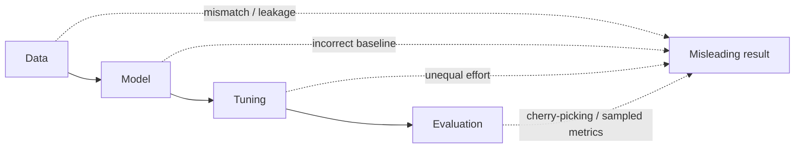

# Reproducibility Protocol for New Models

Every new model added to this repo, and every experiment that reports its numbers,
**must** follow this protocol. It turns the five rules of
[*Reproducibility in Recommender Systems: Trust, but Verify*](https://preferred.ai/blog/reproducibility-in-recommender-systems)
(Preferred.AI blog, Aug 2026) into concrete steps in Cornac.

> **Performance = Data + Algorithm + Implementation + Tuning + Evaluation**
>
> A result is a property of the **entire experimental pipeline**, not only of the
> model class. A published number is "a single winning lap on a specific benchmark setup."



| Stage | Common flaw | Required mitigation |
|---|---|---|
| Data | Dataset does not fit the task, inconsistent preprocessing, temporal leakage | Document preprocessing, check that the dataset has the signal the task needs, use time-respecting global splits |
| Model | Wrong or incomplete baseline implementation | Prefer official or vetted implementations, audit the loss, sampling and inference, sanity-check against published numbers |
| Tuning | Defaults for baselines, heavy tuning for the new model | Give every model the same tuning budget and disclose search spaces, budgets and selection criteria |
| Evaluation | Selecting on the test set, sampled negatives | Select only on validation and evaluate on the full item space |

---

## Rule 1: Verify your data assumptions

*"Always ask: what problem did I actually construct from this dataset?"*

**Must do**
- [ ] Write down every preprocessing step: filtering such as k-core, deduplication,
      ID remapping, and binarization thresholds. Use code, not prose. Use the Cornac
      loaders (`cornac.datasets.*`) or commit the preprocessing script.
- [ ] Show that the dataset has the signal your model claims to use.
  - **Sequential models:** run the shuffle test from Klenitskiy et al.
    (RecSys'24). Train and evaluate on the real sequences, then again on sequences
    shuffled within each user. If the score barely drops, the dataset has little
    sequential signal. Report this, and don't claim sequential gains on that dataset.
  - **Bundle models:** show the effect of using bundle membership. For example,
    compare `BundlePop(popularity="item")` against `"bundle"`, or compare your model
    with and without `bundle_item_matrix`.
- [ ] Use a split that matches the task:

  | Split | Leaks future data? | Use when |
  |---|---|---|
  | Random (`RatioSplit`) | **Yes**, trains on the future to predict the past | Only for tasks where time does not matter, and you must say so |
  | User leave-one-out | **Yes**, other users' later interactions leak into training | Avoid for time-sensitive tasks |
  | **Global temporal** (one timestamp cutoff) | No | **Default for any time-sensitive task** |

  Ji et al. (TOIS'23) found that non-temporal splits inflated NDCG@20 by up to
  89.5% and changed which model ranked best.
- [ ] For published benchmarks, use the authors' **fixed splits** instead of
      re-splitting. Bundle example: `bundle.load_feedback(variant, split=...)` with
      `BundleEvaluation.from_splits`. Name the source of the split.

**Bundle-specific notes**
- The CrossCBR splits (Youshu, NetEase, iFashion) are fixed author splits. Use them
  as given.
- `BundleConstructionEvaluation` splits bundles at random. When timestamps exist,
  pass pre-split bundles with `from_splits` (a temporal cutoff). Otherwise, say that
  the split is random.
- Never turn validation or test bundle feedback into user-item feedback. Pass only
  training-time observations as `user_item_data`.

---

## Rule 2: Audit baseline implementations

*"An implementation is part of the experimental method."* Two models with the same
name can behave very differently. In one BPR comparison on MSD, NDCG@100 was 0.3114
in Cornac and 0.0117 in RecBole (Milogradskii et al., RecSys'24). The most-starred
PyTorch GRU4Rec scored 75–99% below the reference (Hidasi & Czapp, RecSys'23).

**Must do, for the new model and for every baseline**
- [ ] Use official or vetted code: the authors' release or the existing Cornac model.
      If you port a model, cite the reference implementation and its commit.
- [ ] Check each part against the paper or reference code, not just the class name:
  - [ ] architecture
  - [ ] loss function (sign, reduction, regularization: shared λ or separate λu/λi/λj)
  - [ ] biases (item and user biases on or off)
  - [ ] negative sampling (uniform, popularity-based or adaptive)
  - [ ] optimizer and its defaults
  - [ ] **inference routine** (how scores are produced at test time)
- [ ] Sanity-check: reproduce at least one published number on the paper's own
      dataset and protocol, or explain the gap. Record the reference number next to yours.
- [ ] Add unit tests under `tests/cornac/models/` that cover `fit`, `score` and the
      dataset-type checks. See `tests/cornac/models/test_recommender.py`.
- [ ] Always include the **simple baselines**: `MostPop` / `BundlePop`, ItemKNN or
      UserKNN, EASE, and tuned MF/BPR. Past reproducibility studies
      (Ferrari Dacrema'19, Rendle'20, Anelli'23, Shehzad'25) found that tuned simple
      models often match or beat new neural models.

---

## Rule 3: Give every model the same tuning effort

*With enough asymmetry, "everyone's a winner."* Untuned neural models can lose to
MostPop (Shehzad & Jannach, RecSys'23). Under fair tuning, simpler baselines beat
every diffusion recommender studied (Benigni et al., TORS'26).

**Must do**
- [ ] Tune **every** trainable model, the baselines included, with the **same search
      method and the same budget**. For example, `RandomSearch(..., n_trails=N)` with
      the same `N` for every model, or a similar number of GPU-hours.
- [ ] Tune **only on the validation set**. Cornac's `GridSearch` and `RandomSearch`
      (`cornac/hyperopt.py`) require `val_set` and score each setting on it.
- [ ] Use one fixed selection metric for all models, for example `NDCG(k=20)` on
      validation.
- [ ] Report, for every model: the full search space, the budget, the selection
      metric, and the chosen values. Don't report only the winning values.

---

## Rule 4: Use clean evaluation protocols

| Split | Use it for |
|---|---|
| Train | Fitting parameters |
| Validation | Tuning hyperparameters, choosing checkpoints, early stopping |
| Test | Measuring the final result **once**, after every choice is fixed |

**Must do**
- [ ] **Never** compute test metrics every epoch and report the best one. That is
      test-set cherry-picking. Early stopping must look at `val_set` only.
- [ ] Evaluate against the **full candidate catalog**. Don't rank against "99 sampled
      negatives". Krichene & Rendle (KDD'20) showed that sampled metrics can reverse
      model rankings and end up measuring something closer to AUC. Cornac's
      `ranking_eval` already ranks the full catalog:
  - `BundleEvaluation` ranks **all catalog bundles**, including bundles with no
    feedback.
  - `BundleConstructionEvaluation` ranks **all items except the given ones**.
- [ ] Sampling is allowed only to study a candidate-retrieval stage that has a
      defined candidate generator. In that case, report full-catalog results as well
      and justify the choice.
- [ ] State the masking protocol. For bundles, give the `test_mask` value
      (`'train'` follows CrossCBR, `'train_and_validation'` is stricter).
- [ ] Report several random seeds (at least 3–5), with the mean ± standard deviation.

---

## Rule 5: Publish the full pipeline

**Must commit or release**
- [ ] Preprocessing code, from raw data to the files used
- [ ] Code for the model and for **every baseline**, with versions or commits
- [ ] The evaluation script: the template below, filled in
- [ ] Seeds and configs: split seed, model seeds, search spaces, budgets
- [ ] Environment: Python, Cornac commit (`git rev-parse HEAD`), and torch or numpy versions
- [ ] Raw result logs. Set `cornac.Experiment(save_dir=...)` to write `CornacExp-*.log`

---

## Experiment script template

Copy this to `examples/<model>_<dataset>_repro.py` and replace the `TODO` parts.
The example uses bundle recommendation on the Youshu fixed splits. For completion or
construction, swap in `BundleConstructionEvaluation` with the same pattern.

```python
"""Reproducible experiment: <MODEL> vs baselines on <DATASET>.

Protocol: docs/new_model_reproducibility_checklist.md
Split: CrossCBR fixed author split (Rule 1). Full-catalog ranking (Rule 4).
Equal RandomSearch budget on validation for all trainable models (Rule 3).
"""

import json
import platform
import subprocess

import numpy as np

import cornac
from cornac.datasets import bundle
from cornac.eval_methods import BundleEvaluation
from cornac.hyperopt import Continuous, Discrete, RandomSearch
from cornac.metrics import NDCG, Recall
from cornac.models import BPR, BundlePop, MostPop

# ---------------------------------------------------------------- config
DATASET = "Youshu"
SEEDS = [1, 2, 3, 4, 5]              # Rule 4: several seeds
N_TRIALS = 20                        # Rule 3: same budget for EVERY tuned model
SELECT_METRIC = NDCG(k=20)           # Rule 3: same validation metric for all
METRICS = [Recall(k=20), NDCG(k=20)]
SAVE_DIR = "results/{}_repro".format(DATASET)


def environment():
    """Rule 5: record what produced these numbers."""
    commit = subprocess.run(
        ["git", "rev-parse", "HEAD"], capture_output=True, text=True
    ).stdout.strip()
    return {"python": platform.python_version(), "cornac_commit": commit,
            "numpy": np.__version__}


# ---------------------------------------------------------------- data (Rule 1)
ids = bundle.load_ids(DATASET)
eval_method = BundleEvaluation.from_splits(
    train_data=bundle.load_feedback(DATASET, "train"),
    val_data=bundle.load_feedback(DATASET, "validation"),
    test_data=bundle.load_feedback(DATASET, "test"),
    bundle_item_data=bundle.load_bundle_item(DATASET),
    user_item_data=bundle.load_user_item(DATASET),  # training-time only
    test_mask="train",                               # state the protocol (Rule 4)
    verbose=True,
    **ids,
)

# ---------------------------------------------------------------- search spaces (Rule 3)
# Publish these as written. Give baselines spaces as reasonable as your own model's.
SPACES = {
    "BPR": (
        lambda seed: BPR(k=64, max_iter=200, seed=seed),
        [Discrete("k", [32, 64, 128]),
         Continuous("learning_rate", 1e-4, 1e-1),
         Continuous("lambda_reg", 1e-5, 1e-1)],
    ),
    # "MyModel": (lambda seed: MyModel(seed=seed), [ ... ]),  # TODO: the new model
}

# ---------------------------------------------------------------- run
config = {"dataset": DATASET, "seeds": SEEDS, "n_trials": N_TRIALS,
          "select_metric": SELECT_METRIC.name, "test_mask": "train",
          "spaces": {name: [repr(vars(d)) for d in space]
                     for name, (_, space) in SPACES.items()},
          "env": environment()}
print(json.dumps(config, indent=2))

for seed in SEEDS:
    models = [  # non-trainable baselines need no tuning
        MostPop(),
        BundlePop(name="BundlePop-item", popularity="item"),
        BundlePop(name="BundlePop-user", popularity="user"),
    ]
    for name, (make, space) in SPACES.items():
        models.append(RandomSearch(            # tunes on val_set only (Rule 4)
            model=make(seed), space=space, metric=SELECT_METRIC,
            eval_method=eval_method, n_trails=N_TRIALS,
        ))
    cornac.Experiment(
        eval_method=eval_method, models=models, metrics=METRICS,
        save_dir="{}/seed{}".format(SAVE_DIR, seed),  # raw logs (Rule 5)
    ).run()
    # The test set is scored once per seed, after tuning. Report mean ± std over seeds.
```

---

## Results reporting template

Paste this into the PR description or the paper appendix:

```markdown
### <MODEL> on <DATASET>
- Split: <fixed author split | global temporal cutoff at T | random (justify)>
- Preprocessing: <script path + commit>
- Data-signal check: <e.g. shuffle test: NDCG drops X% → sequential signal present>
- Candidates: full catalog (<N> bundles/items); masking: test_mask=<...>
- Tuning: RandomSearch, <N> trials per model, selected on validation <metric>
- Seeds: <list>; results = mean ± std
- Reference check: <baseline> reproduced <paper number> → ours <number>

| Model | Search space | Best params | Recall@20 | NDCG@20 |
|---|---|---|---|---|
| MostPop | n/a | n/a | | |
| BundlePop-user | n/a | n/a | | |
| BPR | k∈{32,64,128}, lr∈[1e-4,1e-1], λ∈[1e-5,1e-1] | | | |
| <MODEL> | ... | | | |

Environment: Python <x>, Cornac <commit>, <torch/numpy versions>
```

---

## Pre-merge gate (all must be ✅)

| # | Check | Rule |
|---|---|---|
| 1 | Preprocessing is in code, and the split type is stated and justified | 1 |
| 2 | Data-signal check done (shuffle test or ablation) | 1 |
| 3 | Every baseline audited (loss, sampling, optimizer, inference) and a reference number reproduced | 2 |
| 4 | Simple baselines included (MostPop/BundlePop, KNN, EASE, tuned MF/BPR) | 2 |
| 5 | Unit tests added and passing | 2 |
| 6 | Same tuning budget and validation metric for every trainable model | 3 |
| 7 | Search spaces and chosen values reported for every model | 3 |
| 8 | No test-set selection, and early stopping uses validation only | 4 |
| 9 | Full-catalog evaluation, no sampled negatives | 4 |
| 10 | At least 3 seeds, mean ± std reported | 4 |
| 11 | Script, configs, seeds, environment and logs committed | 5 |

*"So, trust, but verify."*

---

## References

- Blog post: https://preferred.ai/blog/reproducibility-in-recommender-systems ([slides](https://preferred.ai/uploads/reproducibility-in-recommender-systems/slides.pdf))
- Klenitskiy et al., *Does It Look Sequential?*, RecSys'24: https://arxiv.org/abs/2408.12008
- Ji et al., temporal data leakage, TOIS'23: https://arxiv.org/abs/2010.11060
- Milogradskii et al., BPR implementations, RecSys'24: https://arxiv.org/abs/2409.14217
- Hidasi & Czapp, GRU4Rec third-party implementations, RecSys'23: https://arxiv.org/abs/2307.14956
- Shehzad & Jannach, *Everyone's a Winner!*, RecSys'23: https://dl.acm.org/doi/10.1145/3604915.3609488
- Benigni, Ferrari Dacrema & Jannach, diffusion recommenders, TORS'26: https://arxiv.org/abs/2505.09364
- Krichene & Rendle, sampled metrics, KDD'20: https://dl.acm.org/doi/pdf/10.1145/3394486.3403226
- Rendle et al., NCF vs MF, RecSys'20: https://arxiv.org/abs/2005.09683
- Ferrari Dacrema et al., RecSys'19 / TOIS'21: https://arxiv.org/abs/1907.06902
- Petrov & Macdonald, BERT4Rec, RecSys'22: https://arxiv.org/abs/2207.07483
- Anelli et al., graph CF, RecSys'23: https://arxiv.org/abs/2308.00404
- Shehzad et al., SIGIR'25: https://arxiv.org/abs/2501.10143
- Shehzad & Jannach, RecSys'25: https://dl.acm.org/doi/pdf/10.1145/3705328.3748156
